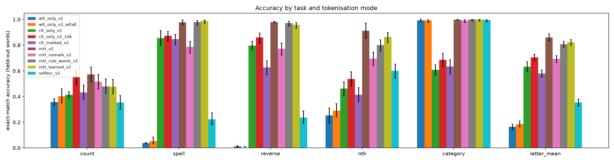
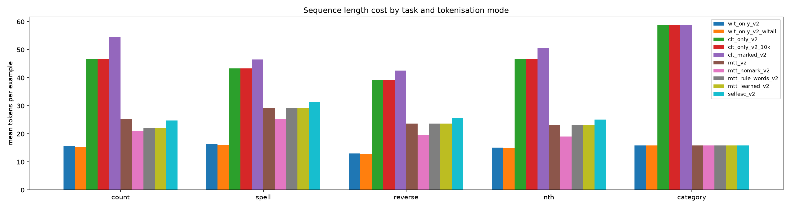
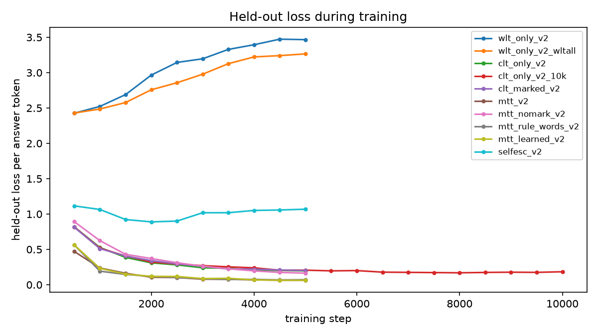
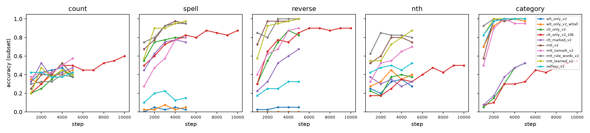

# Multi Tier Tokenisation (MTT): a proof of concept

**Status:** small-scale proof of concept, second round. A 5.3M-parameter model trained from scratch on synthetic prompts, three seeds for the main comparison and one for each follow-up experiment. It shows the mechanism working on letter-level tasks; it does not show that the approach works for real language models or real prompts.

## Summary

Language models read subword tokens, so they never directly see the letters inside a word. That is why they struggle with questions such as "How many r's are in strawberry?". Reading everything letter by letter fixes this but makes every sequence several times longer.

**Multi Tier Tokenisation (MTT)** uses both. Normal text goes through a subword tokeniser (WLT). A router picks out only the words that need letter-level precision and sends those through a character tokeniser (CLT), wrapped in `<CLT> ... </CLT>` markers.

```
Prompt : How many r's are in strawberry?
WLT    : How | many | r | 's | are | in | st | ra | w | berry | ?      (letters are hidden)
MTT    : How many «r»'s are in «s t r a w b e r r y»?                («» = character-level span)
```

The WLT line is the project's real BPE output. Strawberry is a held-out test word for every seed, so the model never saw it during training.

This round carried out the five next steps from the first report: balanced counting data, more seeds, a training-budget control, a robustness test on paraphrased prompts, and self-escalation. It also tested why MTT beats character-only. Same model, same training settings, new data (version 2, described below).

| Claim | Verdict | Evidence |
|---|---|---|
| MTT lets a model spell, reverse and index letters of **unseen words** | **Supported**, 3 seeds | Spell 97.8%, reverse 98.0%, nth letter 91.2%, versus 3.9%, 1.2% and 25.2% for word-only |
| MTT beats character-only on letter tasks | **Supported**, 3 seeds | Letter-task mean 86.1% vs 63.2%; MTT's worst seed (83.0%) beats character-only's best (67.4%) |
| ...and it isn't just that character-only is undertrained | **Supported**, 1 seed | Character-only at twice the steps reaches 70.5% (MTT 83.0% on the same seed), and its held-out loss stops improving after step 6,000 |
| ...at lower cost | **Supported** | Sequences 1.66x word-only length vs 3.34x; training time 1.81x vs 3.45x (each mode timed alone) |
| ...including words longer than those seen in training | **No**, 3 seeds | MTT spells 100% of 4-7 letter words but 11 of 18 nine-letter and 0 of 11 ten-letter prompts. Only 3% of training words have 9+ letters. MTT can't spell "strawberry" |
| MTT does not hurt ordinary tasks | **Supported**, control task | Category 99.8% vs 99.3% word-only; character-only 60.8% |
| MTT helps letter **counting** | **Partly**, 3 seeds | Balanced 4-way counting: 57.2% vs 35.8% word-only and 41.4% character-only (chance 25%). But a model that only knows whether the letter is present would score 50%, and character-only trained twice as long scores 55.0% |
| Why MTT beats character-only | **Partly explained**, 1 seed | Removing the `<CLT>` markers from MTT costs 17 points; adding markers to character-only gains nothing. Shorter sequences alone don't explain it |
| Works for paraphrased, real-world prompts | **No** | With perfect routing, MTT scores 0% on paraphrased spell and reverse prompts and 8.7% across letter tasks: the models learned the templates, not the tasks. No router is reliable on new phrasing either |
| The model can choose its own character spans (self-escalation) | **No**, 1 seed | Letter-task mean 35.3%. It spells the word correctly in its own scratch span only 18-25% of the time |
| Scales to large pretrained models | **Not tested** | |



## What changed since the first report

The first report's results (one seed, data version 1) are kept unchanged in `results/v1/`. This round fixed several problems found while reviewing it:

- **The strawberry question wasn't held out.** "strawberry" was a seed-0 training word, and the first report's tokenisation example (`straw | berry`) was illustrative, not real: that BPE gave it a single token. Version 2 keeps nine showcase words (strawberry, mississippi, banana, raspberry, cheese, pepper, scissors, bookkeeper, tennessee) out of training for every seed.
- **Counting data was skewed** (65% of answers were "1"), and the word list couldn't supply enough hard cases to balance it. Version 2 adds 357 real words with a letter repeated three or more times, used only by the counting task.
- **Running another seed would have overwritten the first run.** Run names now include every non-default setting, finished runs can't be overwritten by accident, and training writes resumable checkpoints.
- **Some report numbers had no generating code** (loss curves, baselines, error tables). `python -m mtt.analyze` now regenerates every table and figure here from committed files.
- **The rule router fired on prompts such as "Spell check my essay" and picked the wrong word in "write the word planet in reverse order"**. Both are fixed; behaviour on the training templates is unchanged.

Because only the counting data changed but all tasks share one model, version-2 numbers for the other tasks are not directly comparable with version 1. They came out close (MTT spell 97.8% vs 100%, nth 91.2% vs 93.3%).

## Method

**Tokenisers.** The combined vocabulary has 2077 ids: 7 special tokens (`<pad> <bos> <eos> <unk> <sep> <CLT> </CLT>`), a 2000-entry byte-level BPE (WLT, trained on the project's own training text), and 70 character tokens (CLT: `a-z`, `0-9`, ASCII punctuation, space, and a `<CAP>` marker for capital letters). Every character is exactly one token id. The WLT and CLT id ranges do not overlap, and decoding reconstructs the original text exactly.

**Routers.** All extract the *target word* (and for counting, the target letter) as character spans, never the whole prompt.
- **Rule router** (used for all `mtt` runs unless noted): regular expressions for each letter task.
- **Learned router:** two hashed character-n-gram logistic regressions; routes words that are rare in the training prompts.
- **Tagger router (new):** masks each word in turn and asks a classifier whether the prompt still looks like a letter task; routes the single best word, and for counting the letter. It is trained on a separate set of phrasings (`ROUTER_TRAIN_TEMPLATES`), never on the test paraphrases.
- **Oracle router (new, evaluation only):** the gold spans. Comparing it with the real routers separates router failure from model failure.

**Sequence format.** `<bos> prompt <sep> answer <eos>`, with loss on the answer tokens only. Answers made of letters (spell, reverse, nth) are also CLT-encoded in MTT mode; the count answer is a single digit and stays WLT.

| Mode | Prompt | Answer |
|---|---|---|
| `wlt_only` | all WLT | WLT |
| `clt_only` | all CLT | CLT |
| `mtt` | router-selected words in CLT, rest WLT | CLT for letter answers, WLT for count digits |
| `selfesc` | all WLT | the model writes `<CLT> word </CLT>` itself, then answers as in `mtt` |
| `clt_marked` (ablation) | all CLT, with the target word also wrapped in markers | CLT |
| `mtt_nomark` (ablation) | as `mtt`, without the markers | as `mtt`, without the markers |

## Experimental setup

- **Tasks (all exact-match):** `count` ("How many r's are in strawberry?" -> "3"), `spell` ("Spell the word: banana" -> "b a n a n a"), `reverse` ("Reverse the word: planet" -> "tenalp"), `nth` ("What is the 4th letter of garden?" -> "d"), and `category` (control task: "Which of these is a fruit: apple, car?" -> "apple").
- **Data (version 2):** an embedded list of 1117 words split 80/20 into training and held-out words with no overlap, plus 357 repeated-letter words used only for counting, split the same way. 3000 training and 300 test examples per task, from 4-5 templates per task. Counting answers are balanced: 0, 1, 2 and 3+ each make up a quarter of training and test, with the queried letter rotated within each class so the letter alone gives little away. Test prompts use only held-out words (except `category`, which reuses a fixed item vocabulary, so it tests unseen combinations rather than unseen words).
- **Extra test sets:** `count_natural` (300 counting prompts with the old, skewed answer distribution), `showcase` (75 counting prompts on the nine showcase words) and `paraphrase` (200 prompts per task in about 12 new phrasings per task, written before any router change and never used to tune or train anything).
- **Model:** decoder-only transformer, 6 layers, 4 heads, d_model 256, block size 128, **5,303,552 parameters**, identical in every mode (including the full 2077-id vocabulary and identical initial weights for a given seed).
- **Training:** AdamW (betas 0.9/0.95, weight decay 0.01), learning rate 1e-3 with 200 warm-up steps then cosine decay to 10%, batch 64, 5000 steps, dropout 0.1, gradient clipping 1.0. Same examples and same batch order in every mode for a given seed. Unchanged from the first report and never tuned on the test set.
- **Seeds:** `wlt_only`, `clt_only` and `mtt` were trained with seeds 0, 1 and 2. A seed changes the word split, the examples, the initial weights and the batch order. The follow-up runs use seed 0 only.
- **Statistics:** multi-seed results are mean ± SD across seeds. Single runs show a 95% Wilson interval over the 300 test prompts. Differences between modes use a paired bootstrap that resamples test *words* rather than prompts, because each word appears in about five prompts; it is paired by seed. Single-seed comparisons can only support large effects.
- **Hardware:** one PC with an Intel i7-14700T CPU (20 cores), no GPU. The 16 runs were trained six at a time on three threads each (about 16 hours).

## Results

### Main comparison (3 seeds)

| task | wlt_only | clt_only | mtt |
|---|---|---|---|
| count (balanced, chance 0.25) | 0.358 ± 0.026 | 0.414 ± 0.023 | **0.572 ± 0.059** |
| spell | 0.039 ± 0.004 | 0.856 ± 0.059 | **0.978 ± 0.019** |
| reverse | 0.012 ± 0.007 | 0.797 ± 0.032 | **0.980 ± 0.006** |
| nth | 0.252 ± 0.059 | 0.462 ± 0.053 | **0.912 ± 0.060** |
| category (control) | 0.993 ± 0.009 | 0.608 ± 0.040 | **0.998 ± 0.002** |
| **mean, letter tasks** | 0.165 ± 0.021 | 0.632 ± 0.040 | **0.861 ± 0.028** |
| letter-task mean by seed (0, 1, 2) | 0.152, 0.190, 0.153 | 0.627, 0.674, 0.595 | 0.830, 0.885, 0.867 |

Accuracy on held-out words, 300 test prompts per task per seed.

MTT minus character-only, paired word-clustered bootstrap over all three seeds: count +15.8 points (95% interval +11.7 to +19.7), spell +12.2 (+9.7 to +15.1), reverse +18.3 (+15.2 to +21.5), nth +45.0 (+41.5 to +48.5), category +39.0 (+35.6 to +42.3). All intervals exclude zero. Seed-to-seed variation is small next to these gaps, except on counting and nth, where MTT's SD is about 6 points.

### Accuracy depends on word length

The averages hide a sharp length effect. Spelling, all three seeds pooled:

| word length (letters) | 4 | 5 | 6 | 7 | 8 | 9 | 10 |
|---|---|---|---|---|---|---|---|
| mtt | 33/33 | 273/273 | 344/344 | 162/162 | 57/59 | 11/18 | **0/11** |
| clt_only | 10/33 | 269/273 | 344/344 | 133/162 | 14/59 | 0/18 | 0/11 |
| training words of this length (seed 0) | 39 | 228 | 348 | 190 | 55 | 22 | 7 |

Reverse and nth show the same pattern (MTT reverses 3 of 11 ten-letter prompts). MTT is near-perfect at the lengths it trained on and fails beyond them: the letters are visible, but the model hasn't learned to copy a span longer than the ones it saw. Character-only also fails on the rarer *short* words, which suggests it learned typical answer lengths rather than copying. **This is why MTT misspells "strawberry" (10 letters) in all three seeds**, for example `s t r a w b r r r r`. Most test words have 5-7 letters, so the headline accuracies mostly measure those lengths.

### All runs

| task | wlt_only (all words) | clt_only 10k steps | clt_marked | mtt_nomark | mtt, learned router | mtt, no letter spans | selfesc |
|---|---|---|---|---|---|---|---|
| count | 0.403 | 0.550 | 0.433 | 0.517 | 0.477 | 0.480 | 0.353 |
| spell | 0.053 | 0.873 | 0.847 | 0.787 | 0.990 | 0.980 | 0.223 |
| reverse | 0.000 | 0.860 | 0.627 | 0.773 | 0.960 | 0.973 | 0.237 |
| nth | 0.290 | 0.537 | 0.413 | 0.697 | 0.863 | 0.800 | 0.600 |
| category | 0.993 | 0.687 | 0.633 | 0.993 | 1.000 | 1.000 | 0.997 |
| **mean, letter tasks** | 0.187 | 0.705 | 0.580 | 0.693 | 0.823 | 0.808 | 0.353 |

One seed each (seed 0), so individual cells have 95% intervals of roughly ±5 points (full intervals in `results/results.md`).

### Cost



| mode | mean sequence length (training mix) | vs word-only | seconds per training step, run alone | vs word-only |
|---|---|---|---|---|
| wlt_only | 14.2 tokens | 1.00x | 0.725 | 1.00x |
| mtt_nomark | 20.4 | 1.44x | 1.158 | 1.60x |
| mtt | 23.6 | 1.66x | 1.310 | 1.81x |
| selfesc | 23.7 | 1.67x | 1.349 | 1.86x |
| clt_only | 47.4 | 3.34x | 2.501 | 3.45x |
| clt_marked | 51.1 | 3.60x | 2.555 | 3.52x |

Step times come from a separate benchmark (`results/bench.json`): 150 steps of each mode, one at a time, on all 20 threads. The 16 experiment runs shared the CPU six at a time, so their wall-clock times can't be compared across modes. The ratios agree with the first report's full single runs (1.82x for MTT and 3.59x for character-only). Time per token is within about 10% across modes, so cost tracks sequence length. On the letter tasks MTT sequences are 1.5-1.8x word-only length; on category they are identical because the router leaves those prompts alone. Character-only is 2.7-3.7x longer on every task.

### Training curves





Held-out loss for `wlt_only` rises from the first evaluation onward while its training loss falls: it memorises the answers for training words and gains nothing for unseen ones. `selfesc` shows the same pattern from step 2000. The character-level and MTT modes keep improving, and character-only at 10,000 steps stops improving after step 6000. Loss values are per answer token and aren't comparable in absolute terms across modes; the learning curves use only 40 prompts per task and are noisy.

## The next steps, answered

### 1. Balanced counting

With balanced answers, a model can no longer score well by always answering "1". MTT counts better than both other modes, by 21 points over word-only and 16 over character-only, consistent across seeds. But counting is **not solved**:

| configuration | balanced accuracy | recall 0 | recall 1 | recall 2 | recall 3+ | showcase (strawberry etc.) |
|---|---|---|---|---|---|---|
| wlt_only (3 seeds) | 0.358 | 0.369 | 0.333 | 0.138 | 0.591 | 70/225 |
| clt_only (3 seeds) | 0.414 | 0.582 | 0.258 | 0.360 | 0.458 | 39/225 |
| clt_only, 10k steps | 0.550 | 0.560 | 0.520 | 0.507 | 0.613 | 20/75 |
| mtt (3 seeds) | 0.572 | 0.733 | 0.436 | 0.538 | 0.582 | 91/225 |

Baselines that can't count, on the same test sets: always the most common answer 0.250, best answer given only the letter 0.28-0.30, best answer given only the word length 0.33-0.36, and "1 if the letter is in the word, else 0" 0.500.

- MTT beats the presence-only baseline by only 7 points, and even its "is the letter there at all?" answers are imperfect (73% recall on zero counts).
- 85% of MTT's counting errors are off by one class (for example answering 2 for 3+), so it has learned roughly how many, not exactly how many.
- **Character-only trained twice as long catches up** (55.0%, difference from MTT −4 points, interval −11 to +3). MTT's counting advantage at 5000 steps may be mostly a training-speed advantage.
- On the old, skewed distribution (`count_natural`), MTT scores 49.2 ± 12.6%, much lower than the first report's 71.7%, because the models no longer lean on "1".
- Routing the letter itself to CLT made no measurable difference (`--router rule_words`: 48.0% vs 51.0% for the matching seed).

**The strawberry question itself is a poor test.** In two of its three seeds, word-only answered "3" to all 15 strawberry prompts, including "How many z's are in strawberry?". It gets the famous question right while knowing nothing about the word. The showcase set asks about several letters per word for this reason. On it MTT scores 40.4 ± 11.1% and gets the r-count of strawberry right in 11 of 15 prompts across its three seeds, but scissors (4 s's) and tennessee (4 e's) in 0 of 15 each.

Asking the trained models directly (`python -m mtt.ask`, seed 0 unless noted):

| question | wlt_only | clt_only | mtt (seeds 0, 1, 2) |
|---|---|---|---|
| How many r's are in strawberry? (3) | 3 | 1 | 3, 2, 3 |
| How many z's are in strawberry? (0) | 3 | 1 | 0, 1, 0 |
| How many b's are in strawberry? (1) | 3 | 2 | 2, 1, 1 |
| Spell the word: strawberry | `s t r e` | `s r a m b e r y` | `s t r a w b r r r r`, `s t a w w e r r r y`, `s a a a e b b r r y` |

MTT gets the famous question right in two of three seeds, and unlike word-only it isn't answering "3" to everything. But it can't spell the word it is counting in (see word length above).

### 2. More seeds

Three seeds confirm the first report's large effects: in every seed, MTT beats character-only, which beats word-only, on spell, reverse and nth, and character-only does worst on category. Seed-to-seed SD is under 2 points for MTT on spell, reverse and category, and about 6 points on count and nth. The first report's suggestion that digit-form ordinals ("5th") are harder than word-form ("fifth") holds with three seeds: MTT got 61 of 457 digit-form prompts wrong and 18 of 443 word-form. Its nth errors grow with position: 0 of 148 wrong at position 1, 21 of 88 at position 6.

### 3. Training budget

Character-only trained for 10,000 steps (seed 0) improves to a letter-task mean of 70.5%, against 62.7% for the same seed at 5000 steps and 83.0% for MTT. MTT stays ahead on spell (+12 points), reverse (+11), nth (+31) and category (+31), with bootstrap intervals that exclude zero. On counting the gap closes, as described above. Its held-out loss stops improving after step 6000 (between 0.17 and 0.20 for the last 4000 steps), so more steps are unlikely to close the rest. The 10k run also used about four times MTT's training compute (twice the steps, twice the tokens per step).

**Conclusion:** part of the original gap was training budget, mostly on counting; most of it was not.

### 4. Robustness

**Routers on fresh paraphrases** (seed 0; none of these prompts were used to tune or train anything):

| router | target recall | word precision | false alarms on 38 tricky general prompts | in-template accuracy |
|---|---|---|---|---|
| rule | 0.146 | 0.684 | 3/38 | 1.000 |
| learned | 0.946 | 0.399 | 27/38 | 1.000 |
| tagger (new) | 0.743 | 0.751 | 20/38 | 0.997 |

The rule router is precise but misses 85% of new phrasings. The learned router finds the target but routes about 1.5 filler words for each correct one and fires on most tricky general prompts. The new tagger is the best balance on paraphrases but still fires on more than half of the tricky prompts. During development the tagger was checked only on its own training phrasings and the 16 original hand-written examples, never on this set.

**End to end, the model is the bigger problem:**

| letter-task mean on paraphrases | oracle router | rule | learned | tagger |
|---|---|---|---|---|
| mtt (3 seeds) | 0.087 ± 0.019 | 0.017 ± 0.007 | 0.047 ± 0.010 | 0.077 ± 0.023 |

Word-only scores 0.065 ± 0.007 and character-only 0.043 ± 0.007 on the same prompts. **Every model scores 0% on paraphrased spell and reverse, even with perfect routing.** The models answer with the wrong kind of output: for seed 0 under the oracle, 74% of MTT's spell answers and 84% of its reverse answers are a single character, as if it had been asked for a count or the nth letter. Trained on 4-5 templates per task, the models learned to recognise those templates, not the tasks. MTT gives the model access to the letters; it can't tell it what to do with them. Category, which needs no letters, survives better (MTT 64%, word-only 80%, character-only 19%).

**Word-only with the held-out words in its BPE** (`--wlt-corpus all`) made no difference: letter-task mean 18.7%, within the seed spread of the default (16.5 ± 2.1%). Giving the tokeniser whole-word tokens for unseen words doesn't let the model see their letters.

### 5. Self-escalation

In `selfesc` the model gets a plain word-level prompt and has to write `<CLT> word </CLT>` itself before answering. It scored a letter-task mean of 35.3%, better than word-only (15.2%) but far below MTT (83.0%), all for seed 0. The bottleneck is the first step:

| task | model spelled the word correctly in its scratch span | answer right, given a correct scratch | answer right, given a wrong scratch |
|---|---|---|---|
| count | 54/300 | 23/54 | 83/246 |
| spell | 70/300 | 66/70 | 1/230 |
| reverse | 72/300 | 67/72 | 4/228 |
| nth | 76/300 | 70/76 | 110/224 |

When the scratch spelling is right, spell, reverse and nth answers are almost always right. But writing out an unseen word's letters from its subword tokens is exactly the skill the word-only model lacks, so self-escalation moves the problem rather than solving it (for example `dancing` -> scratch `dincangling`). A model would need to know how its tokens are spelled, which a large pretrained model might, and this one can't learn for unseen words from 3000 examples.

### 6. Why MTT beats character-only

The first report suggested two explanations: shorter sequences, and target words being easy to find. Two ablations (one seed each) test them:

| mode | letter-task mean | what it tests |
|---|---|---|
| mtt | 0.830 (seed 0) | |
| mtt_nomark | 0.693 | MTT without `<CLT>` markers |
| clt_only | 0.627 (seed 0) | |
| clt_marked | 0.580 | character-only with the target word marked |

- **The markers matter inside MTT.** Removing them costs 21 points on spell, 20 on reverse and 15 on nth (intervals exclude zero), but nothing on counting. Without markers the model has to infer where the character span starts, which matters most for nth (position counting) and copying.
- **Markers alone don't help character-only.** `clt_marked` is no better than `clt_only` (worse on reverse, 62.7% vs 81.3%). Its sequences are about 8% longer still.
- **Shorter sequences alone help a little.** `mtt_nomark` is short but unmarked and beats character-only by 7 points, a small single-seed difference.
- Category confirms the length effect: in MTT the category prompt is identical to word-only's and scores 99.8%; character-only has to copy an option word out of a long character sequence, and in 352 of its 353 wrong answers across three seeds it wrote a word that isn't in the prompt at all, either another member of the category (`eagle` for "Which one is an animal: lion, cabinet?") or a near-copy (`tram` for `train`).

**Best current explanation:** MTT works because the letters appear as a short, clearly bounded span inside an otherwise compact sequence. The boundary markers and the short context both contribute, and neither alone is enough. With one seed per ablation, this is a well-supported direction, not a settled answer.

## Limitations

- **Toy scale.** A 5M-parameter model trained from scratch on synthetic templates. Behaviour in large pretrained models, which have learned a lot about how their tokens are spelled, is untested.
- **Templates.** Training and test prompts share phrasing. The paraphrase test shows that the trained models don't generalise to new phrasing at all, so all in-template accuracies measure letter access within known tasks, not task understanding.
- **One seed for every follow-up.** The ablation, budget, router and self-escalation results rest on single runs and support only large effects.
- **The same author wrote the paraphrase test set and revised the rule router.** The paraphrases were frozen before the router changes and never used for tuning, but the router fixes were guided by similar intuitions about what real prompts look like. The original 16 hand-written paraphrases no longer count as unseen, because the rule router was revised after inspecting its behaviour on them.
- **Bare phrases.** The revised rule router deliberately ignores bare "Reverse order", "Reverse string" and "Reverse engineering", which are ambiguous without more context. A tiny share of in-template prompts with exactly that form, using one of those words as the target, aren't routed.
- **Easy once letters are visible.** Spell and reverse reduce to copying and rearranging a visible character span. Near-perfect scores should not be extrapolated to harder letter reasoning.
- **Exact match is strict.** One answer, "orange" followed by two spaces, was scored wrong. This affects all modes equally and changes no conclusion.

## Next steps

1. **Train on varied phrasing.** The biggest failure is now task recognition, not letter access. Train with many templates per task (or paraphrases generated by another model) and keep a held-out phrasing set for testing.
2. **Train on a wider range of word lengths**, including words of 10-15 letters, and test on lengths longer than any in training to measure real length generalisation.
3. **Counting.** Test whether counting improves with more training for every mode, or with an explicit step such as the model listing the letters first. Make counting case-insensitive.
4. **Seeds for the ablations.** Run `clt_marked`, `mtt_nomark` and `clt_only` at 10k steps with seeds 1 and 2 to firm up the "why MTT wins" result.
5. **An input-only MTT ablation:** CLT in the prompt but WLT answers, to separate the effect of reading letters from writing them.
6. **New letter tasks** (word length, vowel count) that weren't designed alongside the router.
7. **Pretrained models.** Test MTT spans in a pretrained model, where self-escalation might work because the model already knows how its tokens are spelled.
8. **Engineering:** add a KV cache to generation, and rename `mtt/tokenizers` so it doesn't shadow the HuggingFace package of the same name.

## Reproducing

```bash
pip install -r requirements.txt                    # requirements-lock.txt has the exact versions used
python -m pytest                                   # unit tests
python scripts/run_experiments.py                  # all 16 runs, then evaluation and analysis (about 16 h)
python scripts/run_experiments.py --bench --threads 20 --jobs 1   # cost benchmark
python -m mtt.ask "How many r's are in strawberry?"
```

`scripts/run_experiments.py` resumes interrupted runs and skips finished ones. Per-example predictions for every run and test set are in `results/predictions_*.jsonl`, and `python -m mtt.analyze` regenerates `results/analysis.md`, the loss curves and the learning curves from the committed files, so every number in this report can be recomputed. Tables for every run and test set are in `results/results.md`; the router comparison is in `results/router_comparison.md`. Trained weights (`runs/`) are not committed. The first report's experiment is reproduced with `bash scripts/run_all.sh`.
