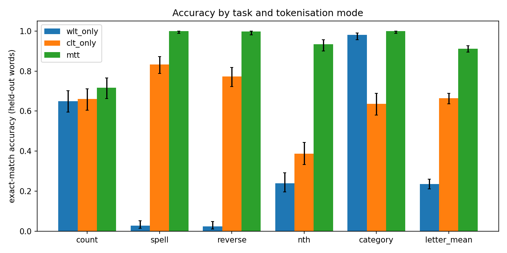
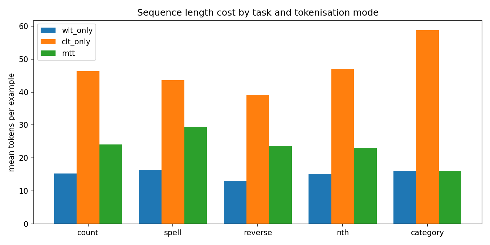
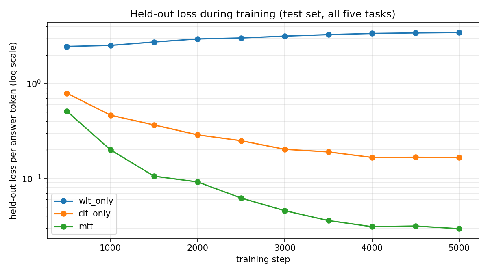

# Multi Tier Tokenisation (MTT): a proof of concept

**Status:** small-scale proof of concept. One training seed, one 5.3M-parameter model, synthetic prompts. It shows the mechanism working on letter-level tasks; it does not show that the approach works for real language models or real prompts.

## Summary

Language models read subword tokens, so they never directly see the letters inside a word. That is why they struggle with questions such as "How many r's are in strawberry?". Reading everything letter by letter fixes this but makes every sequence several times longer.

**Multi Tier Tokenisation (MTT)** uses both. Normal text goes through a subword tokeniser (WLT). A router picks out only the words that need letter-level precision and sends those through a character tokeniser (CLT), wrapped in `<CLT> ... </CLT>` markers.

```
Prompt : How many r's are in strawberry?
WLT    : How | many | r | 's | are | in | straw | berry | ?          (letters are hidden)
MTT    : How many «r»'s are in «s t r a w b e r r y»?              («» = character-level span)
```

We trained the same small transformer from scratch in three modes (word-only, character-only, MTT) on the same data and tested on words that never appeared in any training prompt.

| Claim | Verdict | Evidence |
|---|---|---|
| MTT lets a model spell, reverse and index letters of **unseen words** | **Supported** | Spell 100%, reverse 99.7%, nth letter 93%, versus 2-3%, 2-3% and 24% for word-only |
| MTT beats character-only on letter tasks, at lower cost | **Supported** (this setup) | Letter-task mean 91% vs 66%; training time 1.8x vs 3.6x the word-only baseline |
| MTT does not hurt ordinary tasks | **Supported** (control task) | Category task 100% vs 98% word-only; character-only drops to 64% |
| MTT solves letter **counting** (the strawberry question) | **Not shown** | All three modes score about the same as always answering "1" (64%); training data was badly skewed (see below) |
| Works for paraphrased, real-world prompts | **Not shown** | Rule-based router fired on only 4 of 8 hand-written paraphrased requests, and on one of those it picked the wrong word |
| Why MTT beats character-only | **Untested** | Hypotheses only (see Discussion) |
| Scales to large pretrained models | **Not tested** | |



## Method

**Tokenisers.** The combined vocabulary has 2077 ids: 7 special tokens (`<pad> <bos> <eos> <unk> <sep> <CLT> </CLT>`), a 2000-entry byte-level BPE (WLT, trained on the project's own training text), and 70 character tokens (CLT: `a-z`, `0-9`, ASCII punctuation, space, and a `<CAP>` marker for capital letters). Every character is exactly one token id. The WLT and CLT id ranges do not overlap, and decoding reconstructs the original text exactly.

**Router.** Version 1 is rule-based: regular expressions for letter counting, spelling, reversal, nth-letter and simple ciphers. They extract the *target word* (and for counting, the target letter) as character spans, never the whole prompt. General questions are left alone. The router interface is a single method, `route(prompt)`, so a learned router can replace it (a small learned router is included as a stretch goal; its decision quality is compared below).

**Sequence format.** `<bos> prompt <sep> answer <eos>`, with loss on the answer tokens only. Answers made of letters (spell, reverse, nth) are also CLT-encoded in MTT mode; the count answer is a single digit and stays WLT.

| Mode | Prompt | Answer |
|---|---|---|
| `wlt_only` | all WLT | WLT |
| `clt_only` | all CLT | CLT |
| `mtt` | router-selected words in CLT, rest WLT | CLT for letter answers, WLT for count digits |

## Experimental setup

- **Tasks (all exact-match):** `count` ("How many r's are in strawberry?" -> "3"), `spell` ("Spell the word: banana" -> "b a n a n a"), `reverse` ("Reverse the word: planet" -> "tenalp"), `nth` ("What is the 4th letter of garden?" -> "d"), and `category` (control task: "Which of these is a fruit: apple, car?" -> "apple").
- **Data:** an embedded list of 1117 words, split into 894 training and 223 held-out words with no overlap. 3000 training and 300 test examples per task (15,000 / 1,500), generated from 4-5 templates per task. Test prompts use only held-out words (except `category`, which reuses a small fixed item vocabulary, so it tests unseen prompt combinations rather than unseen words).
- **Model:** decoder-only transformer, 6 layers, 4 heads, d_model 256, block size 128, **5,303,552 parameters**, identical in every mode (including the full 2077-id vocabulary and identical initial weights for a given seed).
- **Training:** AdamW (betas 0.9/0.95, weight decay 0.01), learning rate 1e-3 with 200 warm-up steps then cosine decay to 10%, batch 64, 5000 steps, dropout 0.1, gradient clipping 1.0, seed 0. Same examples and same batch order in every mode. Each run starts from scratch; nothing is carried over between modes. These settings were chosen before any results and never tuned on the test set.
- **Hardware:** a single machine with an Intel i7-14700T CPU.
- **Evaluation:** greedy decoding; the answer string must match exactly. We report 95% Wilson confidence intervals over the 300 prompts per task. There is one seed, so the intervals capture test-set sampling noise but not training-run variation.

## Results

### Accuracy on held-out words

| task | wlt_only | clt_only | mtt |
|---|---|---|---|
| count | 0.650 (0.59-0.70) | 0.660 (0.60-0.71) | 0.717 (0.66-0.76) |
| spell | 0.027 (0.01-0.05) | 0.833 (0.79-0.87) | **1.000** (0.99-1.00) |
| reverse | 0.023 (0.01-0.05) | 0.773 (0.72-0.82) | **0.997** (0.98-1.00) |
| nth | 0.240 (0.20-0.29) | 0.387 (0.33-0.44) | **0.933** (0.90-0.96) |
| category (control) | 0.980 (0.96-0.99) | 0.637 (0.58-0.69) | **1.000** (0.99-1.00) |
| **mean, letter tasks** | 0.235 (0.21-0.26) | 0.663 (0.64-0.69) | **0.912** (0.89-0.93) |
| **mean, all tasks** | 0.384 (0.36-0.41) | 0.658 (0.63-0.68) | **0.929** (0.92-0.94) |

Reference points from the test set: always answering "1" on `count` scores 0.640; always answering the most common letter on `nth` scores 0.087; random guessing among the options on `category` scores 0.41; always answering the most common answer on `spell` and `reverse` scores 0.

### Cost



| mode | mean sequence length (training mix) | vs word-only | training time (5000 steps, CPU) | vs word-only |
|---|---|---|---|---|
| wlt_only | 14.1 tokens | 1.00x | 3513 s (59 min) | 1.00x |
| mtt | 23.4 tokens | 1.66x | 6395 s (1 h 47 min) | 1.82x |
| clt_only | 47.2 tokens | 3.35x | 12627 s (3 h 30 min) | 3.59x |

On the letter tasks MTT sequences are 1.5-1.8x the length of word-only sequences; on the category task they are identical (1.00x) because the router leaves those prompts alone. Character-only is 2.7-3.7x longer on every task. Training time scaled almost linearly with sequence length: time per token differs by under about 10% across the three modes.

### Held-out loss during training



Held-out loss falls steadily for `clt_only` and `mtt`, while `wlt_only` reaches its lowest logged value at step 500 and then rises, even as its training loss falls to about 0.16. That is the signature of memorising the training words: the word-only model learns the answers for words it has seen and gains nothing for words it has not. Loss values are per answer token and are not comparable in absolute terms across modes, because the tokenisers produce different answer lengths; the trend is what matters.

## Analysis

### Where MTT worked

**Spell and reverse.** With the target word visible as characters, MTT scored 300/300 on spelling and 299/300 on reversing held-out words. Word-only managed 8/300 and 7/300, which is what you would expect if it cannot see letters of words it has not learned. Character-only did well (250/300 and 232/300) but made copy errors: in 49 of its 50 spelling mistakes the output was the right length with one wrong character (for example `zone` -> `z o n d`).

**Normal tasks are unaffected.** On `category` MTT's input is token-for-token identical to word-only's. The 100% vs 98% difference is therefore training variation, not a tokenisation effect. Character-only fell to 64%, and in 106 of its 109 wrong answers it produced a plausible member of the category that was *not* one of the options in the prompt (for example answering `monkey` to "Which one is an animal: donkey, bench?"), so it knew the category but failed to copy the right word from a long character sequence.

**Nth letter.** MTT made 20 errors out of 300, all at positions 4-8 (20 of 143 prompts, 14%) and none at positions 1-3 (0 of 157). In 14 of the 20 errors the answer was the letter next to the correct one, i.e. an off-by-one position error. Digit-form ordinals ("5th") failed more often than word-form ("fifth"): 15 of 143 versus 5 of 157. With these small counts that is suggestive, not conclusive. Word-only got the first letter right 55% of the time (23 of 42) but was mostly wrong at later positions.

### Where it did not: counting

No mode learned to count. Predicted answers were overwhelmingly "1":

| true count | prompts | wlt_only correct | clt_only correct | mtt correct |
|---|---|---|---|---|
| 0 | 70 | 22 | 12 | 30 |
| 1 | 192 | 168 | 182 | 173 |
| 2 | 37 | 5 | 4 | 12 |
| 3 | 1 | 0 | 0 | 0 |
| **total** | 300 | 195 | 198 | 215 |

MTT is somewhat better than the others on the rarer cases (30/70 zero-count and 12/37 two-count prompts), and 83% right on the simpler question "is the answer zero or not?", but the "always 1" baseline already scores 64%, and a model that only knew whether the letter appears would score 87%. We treat counting as **unresolved**, not as a failure of the method, because **the training data was heavily skewed**: of 3000 count examples, 1951 had the answer 1, 628 had 0, 394 had 2, and only 26 had 3 and 1 had 4. Real words rarely repeat a letter three times, so the generator gave the model almost no hard cases, and "answer 1" was a strong shortcut. The strawberry example itself (three r's) is exactly the kind of case that was nearly absent. A fair test needs a balanced count dataset.

### Router comparison (no model needed)

| router | decision acc., in-template | target word found, in-template | decision acc., 16 paraphrases | target found, 8 paraphrase positives | spurious spans per paraphrase positive |
|---|---|---|---|---|---|
| rule-based | 1.000 | 1.000 | 12/16 | 3/8 | 0.12 |
| learned (char n-gram logistic regression) | 1.000 | 1.000 | 14/16 | 8/8 | 1.75 |

Both routers are perfect on the training templates, which is expected since the templates and the rules were written together. On 16 hand-written paraphrases the rule router missed four prompts and, for "write the word planet in reverse order", fired on the wrong word ("order"). The learned router found the target word in all eight positives but also sent about 1.75 filler words per prompt to CLT and gave two false alarms on general questions. Only 8 of the 16 paraphrases are positives, so treat this as anecdotal. **MTT's results above assume a router that works; routing robustness on real prompts is the main open risk.**

## Limitations

- **Single seed and one training length.** Differences of a few points could change with another seed. The large gaps (spell, reverse, nth, category for character-only) are far outside the intervals, but small ones (count) are not reliable.
- **Shared templates.** Training and test prompts use the same phrasing; only the words are new. The results say nothing about unseen phrasing.
- **Equal step budget.** Word-only overfits at 5000 steps and character-only, with sequences about 3x longer, may be undertrained. We did not test longer training, so part of the MTT-vs-character-only gap could be training budget.
- **Easy once letters are visible.** Spell and reverse reduce to copying and rearranging a visible character span. Near-perfect scores should not be extrapolated to harder letter reasoning.
- **Toy scale.** A 5M-parameter model on synthetic templates. Behaviour in large pretrained models is untested.
- **Word-only baseline design.** By default the BPE was trained on training words only, so held-out words are split into subwords. A tokeniser that had seen the held-out words as whole tokens (`--wlt-corpus all`) was not run.

## Discussion

The core mechanism works in this setting: giving the model character-level access to just the words that need it lets it handle letter-level tasks on words it has never seen, at about 1.5-1.8x sequence length on those tasks and no extra cost elsewhere, whereas reading everything at character level costs about 3x on every task and hurts ordinary questions.

Why MTT also beat character-only on every letter task is **not established**. Plausible explanations are that its sequences are shorter (easier to attend over precisely) and that the ordinary words stay as compact tokens, but nothing here tests those ideas.

## Next steps

1. **Balanced counting data** (answers 0, 1, 2 and 3+ equally often, with repeated-letter words), then retrain all three modes. This is the test the project was originally motivated by.
2. **More seeds** (e.g. `--seed 1` and `--seed 2`) to turn single-run differences into means with variation.
3. **Control for training budget:** train character-only longer (e.g. 10,000 steps) and compare.
4. **Robustness:** evaluate MTT end-to-end on paraphrased prompts using the learned router, and with `--wlt-corpus all` for the word-only baseline.
5. **Self-escalation (stretch goal, implemented, not yet run):** `--mode selfesc`, where the model itself emits `<CLT> word </CLT>` before answering instead of a router doing it.

## Reproducing

```bash
pip install -r requirements.txt
python -m pytest                                    # unit tests
python -m mtt.train --mode wlt_only                 # about 1 h on a modern CPU
python -m mtt.train --mode clt_only                 # about 3.5 h
python -m mtt.train --mode mtt                      # about 1.8 h
python -m mtt.eval --runs wlt_only clt_only mtt     # writes results/
python -m mtt.eval --router-compare                 # router comparison (no model needed)
python -m mtt.ask "How many r's are in strawberry?" # query the trained runs
```

Timings are from the machine described above. Per-example predictions for every run are in `results/predictions_*.jsonl`; the numbers in this report can be recomputed from them. Trained weights (`runs/`) are not committed.
